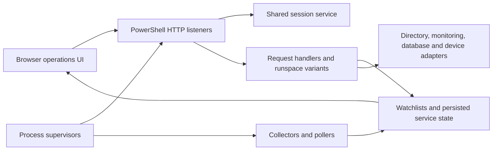

# Architecture and engineering history

This is a conceptual map of related processes, not a claim that every service shared one concurrency or storage implementation.

The runspace-enabled AD API creates a bounded worker pool and associates HTTP request contexts with asynchronous work. Other handlers are sequential. The source preserves both approaches so their scheduling and lifecycle choices can be compared. Shared connections, cleanup paths, and request authorization need review before reuse.

The IPU API selects a fixed command template, inserts an ASCII target suffix twice, and includes a firmware location for software-update commands. A separate tracker compares requested settings with subsequently observed device state. These are outbound protocol reconstruction and state reconciliation; this source does not establish a general inbound telemetry decoder or IP-fragment reassembler.

Siteboss collectors build sensor snapshots and historical records for the browser dashboards. The monitor and chaperone processes supervise related services. PID presence is an imperfect health signal: a process can be alive but unresponsive, and identifiers can be reused. A modern implementation should distinguish process existence, readiness, and service health.

The shared session service demonstrates centralization across applications, but its historical random/session and elapsed-time handling should not be treated as a current security design. The source is retained to explain the system's evolution, not to endorse its deployment defaults.

The modern IPUAPI and SitebossHub repositories isolate meaningful behavior behind synthetic inputs and explicit validation. They are separate extractions, not claims that the original combined deployment was recreated in full.
